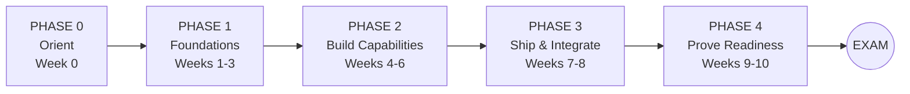
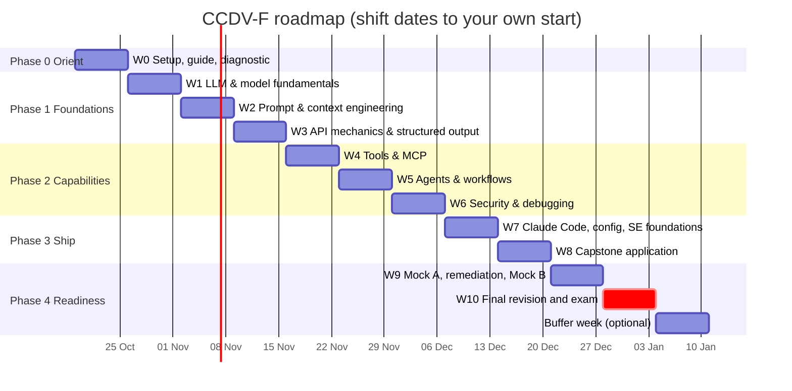
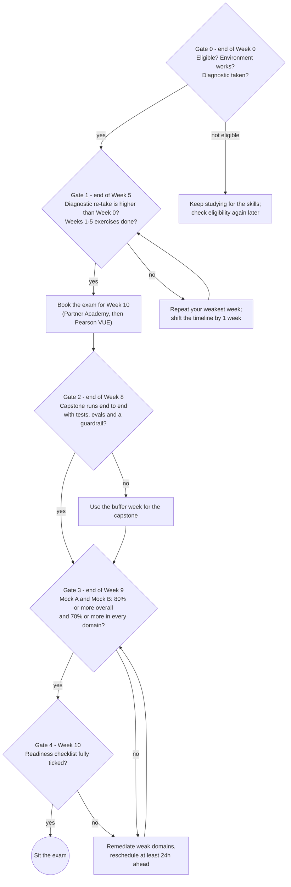

# CCDV-F Roadmap — Claude Certified Developer – Foundations

> One-page view of the journey. Day-by-day detail, exercises, the gap analysis and the checklist are in
> [Preparation-Plan.md](Preparation-Plan.md).

**Pace:** ~7.5 h/week alongside a full-time job · **Duration:** 10 weeks + 1 buffer week · **Total:** ~80 h
**Exam:** 53 items · 120 min · pass = scaled 720/1000 · closed book · Pearson VUE ([official guide v1.0][guide])

> ⚠️ Registration is limited to **Claude Partner Network** organisations with a partner email domain ([FAQ][faq], checked 2026-10-13). Confirm this at Gate 0.

---

## 1. The big picture



| Phase | Weeks | Goal | Domains covered (weight) | Output |
|---|---|---|---|---|
| **0 · Orient** | 0 | Know the exam, set up tools, find your baseline | Read the whole blueprint | Diagnostic score, error log, self-ratings |
| **1 · Foundations** | 1–3 | Understand models, prompts, context and the API state machine | D5 Model Selection (16.8%), D6 Prompt & Context (11%), D2 API Mechanics (6.8%) | Cost calculator, caching experiment, streaming chat with batch + validated JSON |
| **2 · Build Capabilities** | 4–6 | Give Claude tools and autonomy, then make it safe and debuggable | D8 Tools & MCP (10.6%), D1 Agents (14.7%), D7 Security (8.1%), D4 Debugging (2.6%) | MCP server, SDK agent with subagent + hook, injection-hardened app with evals |
| **3 · Ship & Integrate** | 7–8 | Configure for a team and ship one defensible application | D3 Claude Code (3.1%), D2 Config / SE / Requirements / Life Cycle / App Design (26.3% combined) | Team-ready Claude Code repo, capstone app with runbook |
| **4 · Prove Readiness** | 9–10 | Measure, fix weak areas, sit the exam | All, weighted | Two 53-item mocks, remediation notes, cheat sheets |

---

## 2. Timeline (example start: Monday 19 Oct 2026)



> Weeks 9–10 fall over the December holidays if you start on 19 Oct. Either start one week earlier or plan to use the buffer week.

---

## 3. Week-by-week roadmap

| Wk | Theme | Repo lessons ([CCDV-F route][track] + extras\*) | Key official docs | Hands-on milestone | Domain(s) |
|:-:|---|---|---|---|---|
| 0 | Orient | [00][L00] | [Exam guide][guide], [FAQ][faq] | Diagnostic taken, environment ready | — |
| 1 | LLM & model fundamentals | [01][L01], [02][L02] | [Models][d-models], [Choosing a model][d-choose], [Pricing][d-pricing], [Effort][d-effort] | Model router and cost calculator | D5 |
| 2 | Prompt & context | [03][L03], [04][L04], [05][L05] | [Prompt eng.][d-prompt], [Caching][d-cache], [Compaction][d-compact] | Caching experiment with measured savings | D6, D5 |
| 3 | API mechanics | [08][L08], [09][L09] | [Messages][d-messages], [Streaming][d-stream], [Batch][d-batch], [Errors][d-errors] | Streaming chat + batch + validated JSON | D2, D5, D6 |
| 4 | Tools & MCP | [10][L10], [11][L11], [18][L18]\* | [Tool use][d-tools], [MCP build][mcp-build], [Skills][d-skills] | Inventory MCP server in Claude Code | D8 |
| 5 | Agents & workflows | [12][L12], [16][L16]\*, [17][L17]\* | [Agent SDK][d-sdk], [Building effective agents][e-agents] | SDK agent + subagent + hook vs a fixed workflow | D1 |
| 6 | Security & debugging | [13][L13], [14][L14] | [Jailbreaks][d-jail], [Hooks][cc-hooks], [Tests][d-tests] | Injection attack/defence + 10-case evals | D7, D4 |
| 7 | Claude Code & config | [15][L15], [19][L19]\*, [22][L22]\* | [Memory][cc-memory], [Settings][cc-settings], [Skills][cc-skills], [Headless][cc-headless] | Team-ready repo + requirements brief | D3, D2 |
| 8 | Capstone | [30][L30] | Everything above | Capstone app with tests, evals, runbook | All |
| 9 | Mocks | [Mock 01][mock] + self-built Mock B | Your error log | Mock A + B scored by domain | All |
| 10 | Final revision | Cheat sheets | [Exam guide §8 samples][guide] | Readiness checklist complete | All |

\* Extra lessons from the repo that are not in its official CCDV-F track. They are added to cover blueprint gaps (see Preparation-Plan §8).

---

## 4. Priority map: where your hours go

The ordering follows the official weights. **Applications & Integration is one-third of the exam**, so it is studied across four different weeks rather than in one block.

```text
D2 Applications & Integration   33.1% ████████████████████████████████▏   Weeks 1, 3, 7, 8 + mocks
D5 Model Selection & Optim.     16.8% ████████████████▊                   Weeks 1-3
D1 Agents & Workflows           14.7% ██████████████▋                     Week 5
D6 Prompt & Context Eng.        11.0% ███████████                         Week 2
D8 Tools & MCPs                 10.6% ██████████▌                         Week 4
D7 Security & Safety             8.1% ████████                            Week 6
D3 Claude Code                   3.1% ███                                 Week 7
D4 Eval, Testing & Debugging     2.6% ██▌                                 Week 6
```

**Top 5 sub-skills.** Together these make up 34.2% of the exam, so never go into the exam weak on any of them:
1. Claude Application Design — 8.6%
2. Software Engineering Foundations — 7.4% ⚠️ *gap in the repo; study it yourself*
3. Claude API Mechanics — 6.8%
4. Technical Fundamentals (SDKs over REST, websockets) — 6.1% ⚠️ *websockets not covered in the repo*
5. Agent Construction with Claude — 5.3%

---

## 5. Milestones & go/no-go gates



| Gate | When | Pass criteria | If not met |
|---|---|---|---|
| **G0** | End of W0 | Eligibility confirmed · SDK and Claude Code installed · diagnostic score recorded | Keep studying for the skills. Check the [FAQ][faq] again later. |
| **G1** | End of W5 | Diagnostic re-take is higher than in W0 · exercises 1–5 done | Repeat the weakest week, then book the exam |
| **G2** | End of W8 | Capstone runs end to end with tests, evals, a guardrail and a runbook | Use the buffer week |
| **G3** | End of W9 | Both mocks ≥ 80% overall and ≥ 70% per domain (*study heuristic, not the scaled score*) | Remediate. Reschedule **≥ 24 h** before the appointment. |
| **G4** | W10 | Every box in [Preparation-Plan §9][checklist] ticked | Do not sit the exam. Reschedule. |

---

## 6. Fast-track option (6 weeks, ~12 h/week)

Only for people who already build with the Claude API every day. This matches the pace of the repo's 21-day intensive plan, spread over 6 weeks.

| Week | Covers (from the standard plan) |
|:-:|---|
| 1 | W0 + W1 + W2 |
| 2 | W3 + W4 |
| 3 | W5 + W6 |
| 4 | W7 + W8 |
| 5 | W9 (both mocks + remediation) |
| 6 | W10 (revision + exam) |

---

## 7. Key links

- **Sources reviewed:** [claudecertificationguide.com/ccdv-f][site-ccdvf] (independent; its CCDV-F prep track is "Coming soon") · [Local repo certification README][readme] · [CCDV-F track][track]
- **Official:** [Exam Guide v1.0][guide] · [Certification FAQ][faq] · [CCDV-F prep path][prep-path] · [Claude Platform docs][d-home] · [Claude Code docs][cc-overview] · [MCP docs][mcp-intro]
- **Detailed plan:** [Preparation-Plan.md](Preparation-Plan.md)

*Independent study roadmap. It is not affiliated with or endorsed by Anthropic. Exam facts were checked on 2026-10-13 against the official Exam Guide v1.0 and FAQ.*

<!-- ===== Link references ===== -->
[site-ccdvf]: https://claudecertificationguide.com/ccdv-f
[guide]: https://everpath-course-content.s3-accelerate.amazonaws.com/instructor%2F6nizmqk8tpzpfjvt6qmmav7rh%2Fpublic%2F1783542875%2FClaude+Certified+Developer+%E2%80%93+Foundations+Exam+Guide.pdf
[faq]: https://anthropic-partners.skilljar.com/page/faq-certifications
[prep-path]: https://anthropic-partners.skilljar.com/path/claude-certified-developer-foundations
[checklist]: Preparation-Plan.md#9-final-readiness-checklist

[readme]: ../../ai-engineering-from-scratch/certifications/claude/README.md
[track]: ../../ai-engineering-from-scratch/certifications/claude/tracks/ccdv-f.json
[mock]: ../../ai-engineering-from-scratch/certifications/claude/assessments/ccdv-f/mock-01.json

[L00]: ../../ai-engineering-from-scratch/certifications/claude/lessons/00-certification-strategy/docs/en.md
[L01]: ../../ai-engineering-from-scratch/certifications/claude/lessons/01-claude-product-and-model-landscape/docs/en.md
[L02]: ../../ai-engineering-from-scratch/certifications/claude/lessons/02-model-selection-and-token-economics/docs/en.md
[L03]: ../../ai-engineering-from-scratch/certifications/claude/lessons/03-prompting-and-task-decomposition/docs/en.md
[L04]: ../../ai-engineering-from-scratch/certifications/claude/lessons/04-context-knowledge-memory-and-caching/docs/en.md
[L05]: ../../ai-engineering-from-scratch/certifications/claude/lessons/05-output-evaluation-and-validation/docs/en.md
[L08]: ../../ai-engineering-from-scratch/certifications/claude/lessons/08-messages-api-and-application-lifecycle/docs/en.md
[L09]: ../../ai-engineering-from-scratch/certifications/claude/lessons/09-structured-output-and-defensive-parsing/docs/en.md
[L10]: ../../ai-engineering-from-scratch/certifications/claude/lessons/10-tool-use-and-agentic-loops/docs/en.md
[L11]: ../../ai-engineering-from-scratch/certifications/claude/lessons/11-mcp-server-design-and-integration/docs/en.md
[L12]: ../../ai-engineering-from-scratch/certifications/claude/lessons/12-claude-agent-sdk-and-hooks/docs/en.md
[L13]: ../../ai-engineering-from-scratch/certifications/claude/lessons/13-application-security-and-secrets/docs/en.md
[L14]: ../../ai-engineering-from-scratch/certifications/claude/lessons/14-evals-testing-debugging-and-observability/docs/en.md
[L15]: ../../ai-engineering-from-scratch/certifications/claude/lessons/15-claude-code-for-development-teams/docs/en.md
[L16]: ../../ai-engineering-from-scratch/certifications/claude/lessons/16-multi-agent-orchestration-and-delegation/docs/en.md
[L17]: ../../ai-engineering-from-scratch/certifications/claude/lessons/17-agent-sdk-sessions-subagents-and-context/docs/en.md
[L18]: ../../ai-engineering-from-scratch/certifications/claude/lessons/18-tool-contracts-errors-and-progressive-discovery/docs/en.md
[L19]: ../../ai-engineering-from-scratch/certifications/claude/lessons/19-claude-code-memory-rules-skills-and-ci/docs/en.md
[L22]: ../../ai-engineering-from-scratch/certifications/claude/lessons/22-business-discovery-requirements-and-slas/docs/en.md
[L30]: ../../ai-engineering-from-scratch/certifications/claude/lessons/30-developer-application-capstone/docs/en.md

[d-home]: https://platform.claude.com/docs/en/home
[d-models]: https://platform.claude.com/docs/en/models/overview
[d-choose]: https://platform.claude.com/docs/en/about-claude/models/choosing-a-model
[d-pricing]: https://platform.claude.com/docs/en/about-claude/pricing
[d-effort]: https://platform.claude.com/docs/en/build-with-claude/effort
[d-prompt]: https://platform.claude.com/docs/en/build-with-claude/prompt-engineering/overview
[d-cache]: https://platform.claude.com/docs/en/build-with-claude/prompt-caching
[d-compact]: https://platform.claude.com/docs/en/build-with-claude/compaction
[d-messages]: https://platform.claude.com/docs/en/api/messages
[d-stream]: https://platform.claude.com/docs/en/build-with-claude/streaming
[d-batch]: https://platform.claude.com/docs/en/build-with-claude/batch-processing
[d-errors]: https://platform.claude.com/docs/en/api/errors
[d-tools]: https://platform.claude.com/docs/en/agents-and-tools/tool-use/overview
[d-skills]: https://platform.claude.com/docs/en/agents-and-tools/agent-skills/overview
[d-sdk]: https://code.claude.com/docs/en/agent-sdk/overview
[d-jail]: https://platform.claude.com/docs/en/test-and-evaluate/strengthen-guardrails/mitigate-jailbreaks
[d-tests]: https://platform.claude.com/docs/en/test-and-evaluate/develop-tests

[cc-overview]: https://code.claude.com/docs/en/overview
[cc-hooks]: https://code.claude.com/docs/en/hooks
[cc-memory]: https://code.claude.com/docs/en/memory
[cc-settings]: https://code.claude.com/docs/en/settings
[cc-skills]: https://code.claude.com/docs/en/skills
[cc-headless]: https://code.claude.com/docs/en/headless

[mcp-intro]: https://modelcontextprotocol.io/docs/getting-started/intro
[mcp-build]: https://modelcontextprotocol.io/docs/develop/build-server

[e-agents]: https://www.anthropic.com/engineering/building-effective-agents
